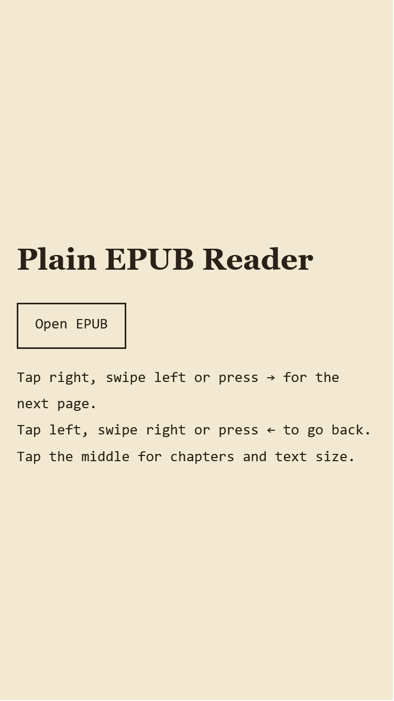
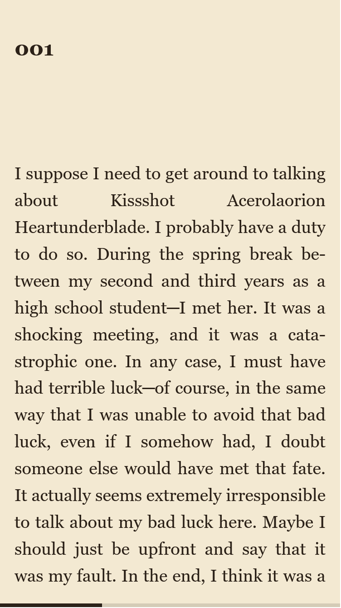

# Plain EPUB Reader

A minimal EPUB reader in a single HTML file. No install, no build step, no dependencies. Open `index.html` in a browser, pick a book, and read.

## Demo

<table>
  <tr>
      <td width="25%"></td>
    <td width="25%"></td>
    <td width="25%"></td>
    <td width="25%"></td>
  </tr>
  <tr>
    <td align="center"><b>Start</b></td>
    <td align="center"><b>Cover</b></td>
    <td align="center"><b>Reading</b></td>
    <td align="center"><b>Menu</b></td>
  </tr>
</table>

## Features

- **One file.** Everything lives in `index.html`: markup, styles, and script.
- **Works offline.** The book is read in the browser and never uploaded anywhere.
- **Paged reading.** Text is split into screen-sized pages instead of one long scroll.
- **Mobile friendly.** Fits small screens, notches, and landscape mode.
- **Full-page covers.** A chapter that is only one image fills the whole screen.
- **Chapter list.** Supports the table of contents of both EPUB 2 and EPUB 3.
- **Adjustable text size.** From 13px to 32px.
- **Remembers your place.** Reading position per book and text size are saved in the browser.
- **Simple progress bar.** A thin line at the bottom shows how far you are in the book.

## Controls

| Action | Touch | Keyboard |
| --- | --- | --- |
| Next page | Tap right side or swipe left | `→` or `Space` |
| Previous page | Tap left side or swipe right | `←` |
| Chapters and text size | Tap the middle | |

## Usage

1. Download `index.html`, or clone this repository.
2. Open the file in a browser.
3. Choose **Open EPUB** and select a book.

To put it online, host `index.html` on any static hosting such as GitHub Pages.

## How it works

- A small built-in ZIP reader unpacks the EPUB using the browser's `DecompressionStream`.
- Chapters are cleaned of scripts and styles from the book, then laid out with CSS columns to create pages.
- Position and text size are stored in `localStorage`.

## Limitations

- EPUB files with DRM cannot be opened.
- Needs a recent version of Chrome, Edge, Safari, or Firefox.
- The book's own styling is removed, so every book uses the reader's typography.
